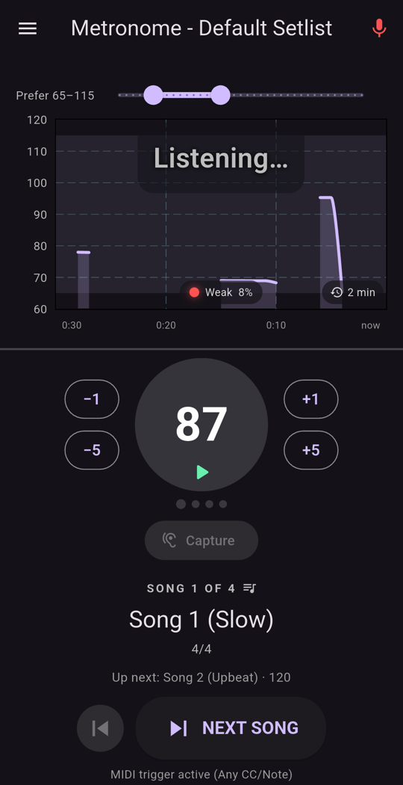

<p align="center">
  
</p>

# SCBeatWiz

**A setlist metronome that listens.** SCBeatWiz counts your band in at each
song's tempo, then listens through the microphone and shows the tempo you're
*actually* playing — live, for any kind of music: full drum kits, finger
snaps, solo piano, strummed guitar or a lone bass line.

<p align="center">
  
</p>

## Features

- **Live tempo detection** from the mic, with a confidence light so you know
  when to trust the number.
- **Tempo history graph** — see if you're rushing or dragging over the course
  of a song.
- **Setlists** with a target BPM per song, saved on the device.
- **Count-in metronome** that starts with each song and steps aside
  automatically once the band locks onto the tempo.
- **Nudge (±1, ±5) or capture** the tempo you're hearing to fix up a song's BPM
  on the spot.
- **MIDI foot-switch support** — any MIDI note or CC advances to the next song.
- **Screen stays on** while listening, so it's readable on stage.

## Using the app

On first launch, allow microphone access. The app starts listening right away
(the 🎤 icon in the top bar turns listening on and off).

### The tempo graph (top half)

| Element | What it shows |
|---|---|
| **Big number** | The tempo being heard right now. Shows *Listening…* when there isn't a clear beat, *Mic off* when the mic is off. |
| **Confidence light** | 🟢 *Strong* — trust it. 🟡 *Fair* — probably right (typical for sparse piano or guitar). 🔴 *Weak* — just noise or no steady pulse. ⚪ *No beat* — silence or mic off. |
| **Graph** | Detected tempo over time. The time axis counts back from **now** (e.g. 4:00 · 3:00 · 2:00 · 1:00 · now) and both axes zoom to fit the readings. |
| **🕘 chip** | How long readings stay on the graph (1–10 min, default 4 — about one song). Tap to change. |
| **Prefer slider** | The tempo range the detector favours when a song could be heard at half or double speed (e.g. 70 vs 140). It centres itself on each song's BPM; drag the handles to make it wider or narrower. The shaded band on the graph shows it. |

### The metronome and setlist (bottom half)

- **The circle** pulses at the current song's BPM. **Tap it** to start or stop
  the metronome (▶ / ■).
- **−5 / −1 / +1 / +5** change the current song's BPM and save it.
- **Capture** saves the tempo you're hearing as the song's BPM (the button
  shows the number it will save). A message confirms it, with **Undo**.
- **Next Song** moves to the next song in the setlist and starts the
  metronome.

### Count-in auto-pause

When you move to a new song, the metronome starts so the band can count in.
Once the detected tempo stays within about 3% of the song's BPM for 3 seconds,
the metronome pauses and the app shows *"Locked on … BPM — metronome paused"*.
From there, follow the detected tempo. If you start or stop the metronome
yourself, it won't auto-pause until the next song.

### Setlists

Open the ☰ menu to switch playlists, create a new one, or edit/delete an
existing one. In the editor you can rename the playlist, add songs (name +
BPM), edit or delete them, and drag to reorder.

### MIDI

Connect a MIDI controller or foot switch. Any **Note On** or **Control Change**
message advances to the next song, just like tapping *Next Song*.

### Tips

- Put the phone where it can hear the whole band, not right next to one loud
  instrument.
- Give it a few seconds: the first reading appears after about 3 s, and it
  averages the last 8 s, so sudden tempo jumps take a few seconds to show.
- Free-time playing (rubato) will read as *Weak* — that's expected; there's no
  steady pulse to find.

## Development setup

### Requirements

- [Flutter](https://docs.flutter.dev/get-started/install) stable (developed on
  3.38; Dart ≥ 3.10)
- Android SDK + platform tools (`adb`), most easily via
  [Android Studio](https://developer.android.com/studio)
- An Android emulator or an Android phone with USB debugging enabled
- Optional: VS Code or Android Studio with the Flutter plugin

Android is the primary, tested platform. The iOS and macOS projects include
microphone permissions but haven't been tested; web, Windows and Linux are
untested scaffolding.

### Get the code

```bash
git clone https://github.com/greenlava82/SCBeatWiz.git
cd SCBeatWiz
flutter pub get
flutter doctor   # check the Android toolchain section
```

### Run on an emulator

```bash
flutter emulators                          # list emulators
flutter emulators --launch <emulator-id>
flutter run -d emulator-5554
```

For the emulator to hear audio, open **Extended Controls (⋯) → Microphone**
and enable **Virtual microphone uses host audio input**. MIDI needs real
hardware.

### Run on a phone

1. Enable **Developer options** (Settings → About phone → tap *Build number*
   7 times) and turn on **USB debugging**.
2. Connect via USB, accept the prompt on the phone, and check `adb devices`.
3. Run it:

   ```bash
   flutter devices
   flutter run -d <device-id>              # debug, with hot reload (r / R)
   flutter run --release -d <device-id>    # use release to judge tempo timing
   ```

Wireless debugging (Android 11+) also works: pair with `adb pair <ip>:<port>`,
then `adb connect <ip>:<port>`.

### Build an APK

```bash
flutter build apk --release
adb install -r build/app/outputs/flutter-apk/app-release.apk
```

Release builds are currently signed with the debug key — fine for sideloading,
not for the Play Store.

### Test and analyze

```bash
flutter analyze lib test
flutter test
flutter test test/tempo_detector_test.dart -r expanded   # prints each detected tempo
```

The tempo detector tests synthesize audio (drums, snaps, piano chords and
arpeggios, guitar strums, legato bass, swing, 3/4, a tempo change, noise and
silence) and check the detected BPM, so detector changes can be verified
without a device.

### Icon and splash screen

The icon and splash artwork are drawn in code, so they can be tweaked and
regenerated for every platform:

```bash
flutter test tool/render_branding_test.dart   # writes assets/branding/*.png
dart run flutter_launcher_icons               # app icons (flutter_launcher_icons.yaml)
dart run flutter_native_splash:create         # splash screens (flutter_native_splash.yaml)
```

### Project layout

```
lib/
  main.dart             UI and app state: setlists, metronome, graph, mic, MIDI
  tempo_detector.dart   Real-time tempo detection (pure Dart)
  tempo_lock.dart       Decides when the band has locked onto the target tempo
test/
  tempo_detector_test.dart   Synthetic-audio detection tests
  tempo_lock_test.dart       TempoLock unit tests
  widget_test.dart           App smoke test
```

### How the tempo detection works

1. **Onsets** — a short-time FFT (46 ms window, 10 ms hop) is split into
   ~50 log-spaced bands from 30 Hz to 16 kHz. The onset signal is the rise in
   each band compared with 20 ms earlier, so it reacts to *new* sound — drum
   hits and snaps, but also piano, guitar and bass notes changing pitch.
2. **Periodicity** — the autocorrelation of the last 8 s of onsets is scored
   for every tempo from 40 to 220 BPM with a harmonic comb (the beat should
   repeat at 1×, 2×, 3× and 4× its period).
3. **Half or double?** — the preferred range and the song's BPM decide between
   readings like 70 and 140, which the audio alone can't settle.
4. **Smoothing** — scores are blended over time so the number is steady but
   still follows real tempo changes.

### Contributing

Work on a feature branch and open a pull request against `main`. Keep commits
atomic — one feature or concern per commit, each passing `flutter analyze` and
`flutter test`. See [CLAUDE.md](CLAUDE.md) for the full conventions.

## License

[MIT](LICENSE) © 2026 Dan Tang
