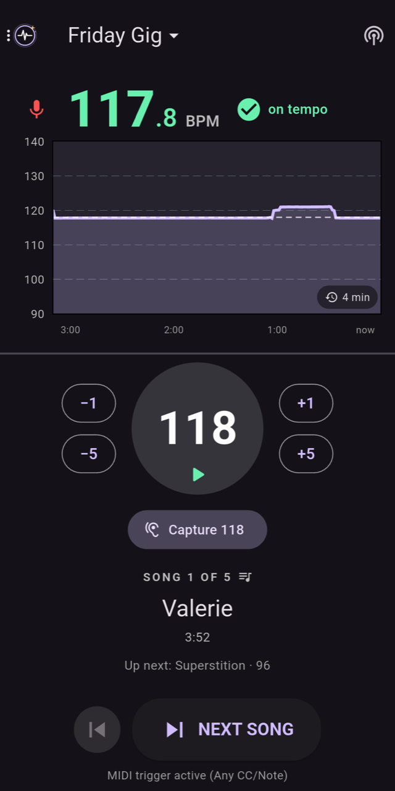
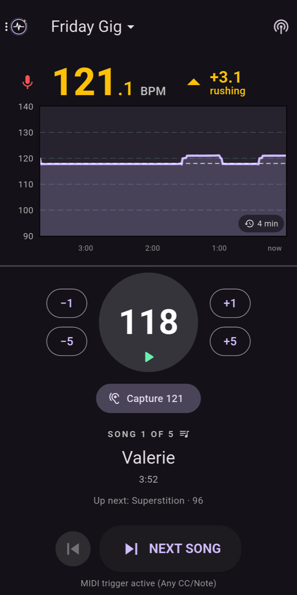
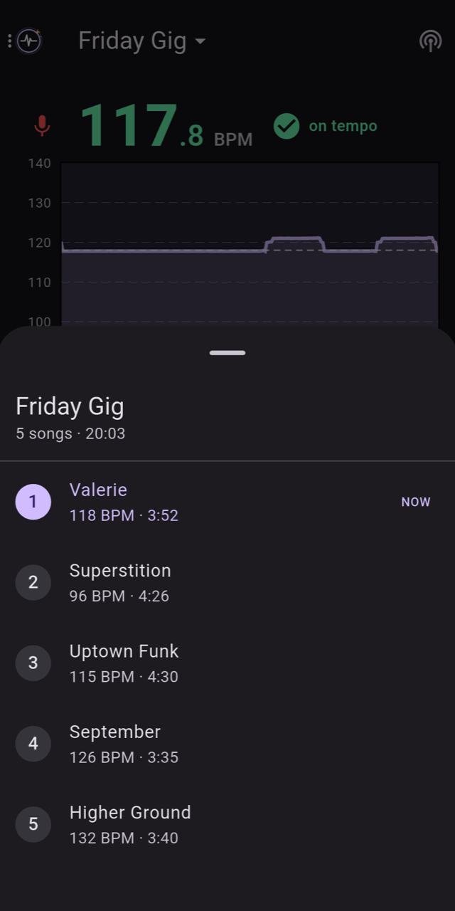
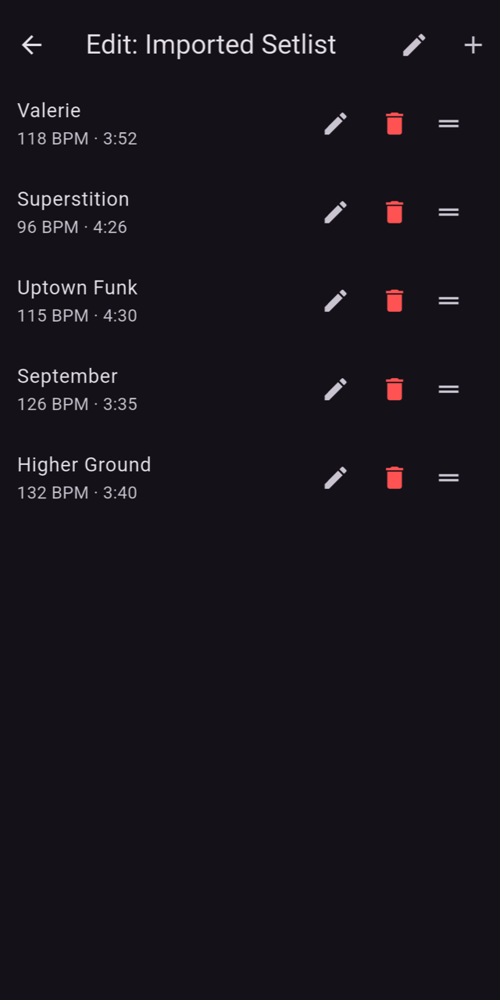
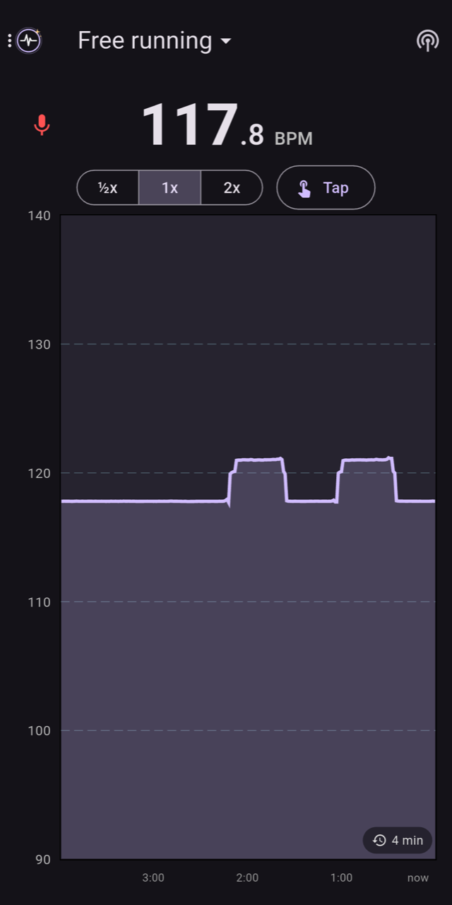
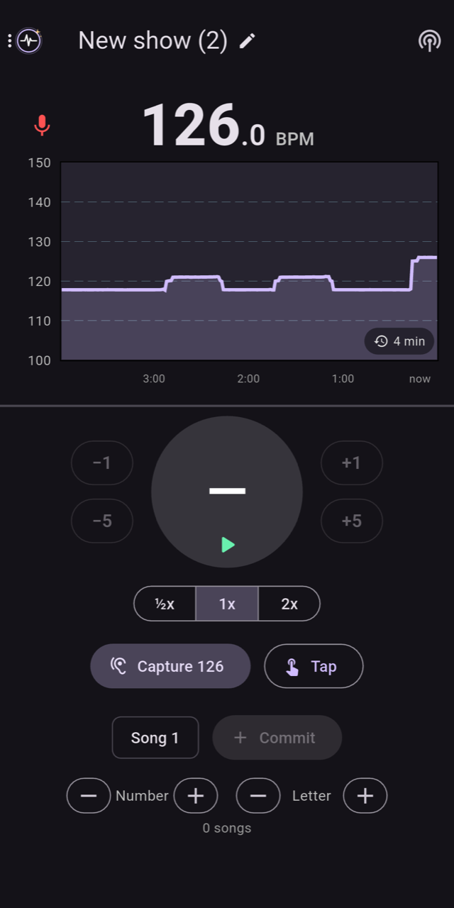
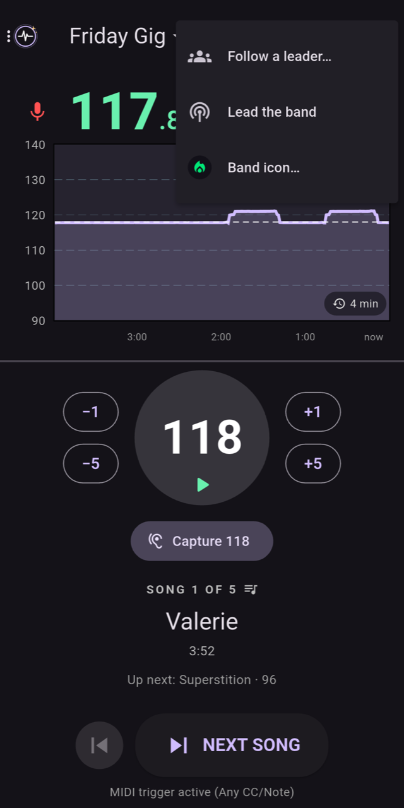
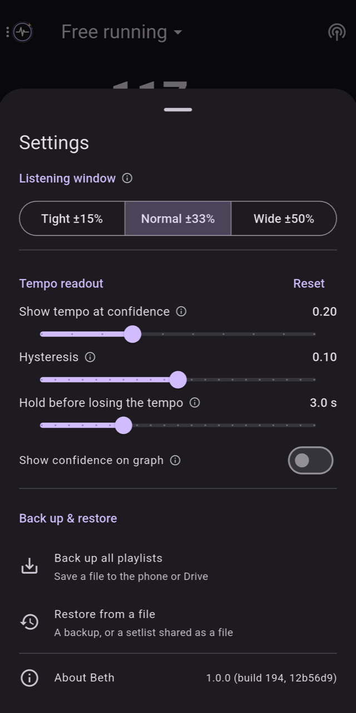
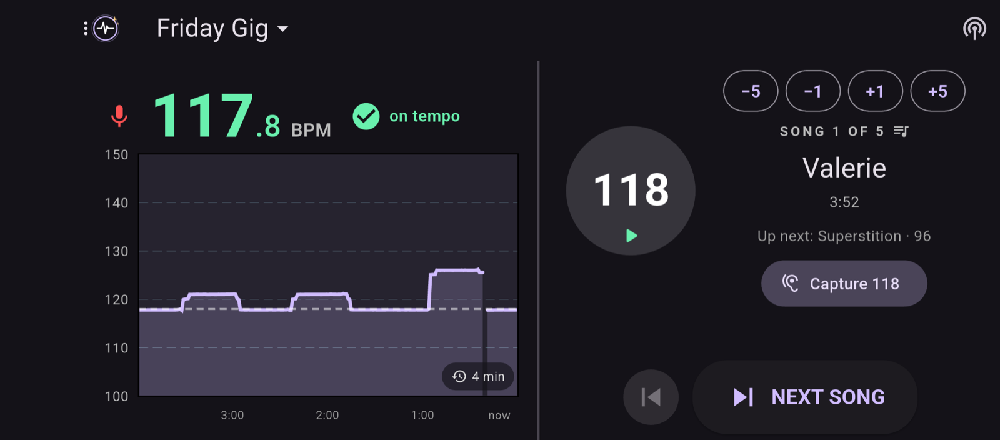

<p align="center">
  
</p>

# Beth

**A setlist metronome that listens.** Beth counts your band in at each
song's tempo, then listens through the microphone and shows the tempo you're
*actually* playing — live, for any kind of music: full drum kits, finger
snaps, solo piano, strummed guitar or a lone bass line.

**Website: <https://greenlava82.github.io/Beth/>**

<p align="center">
  
  
  
</p>

## Features

- **Live tempo detection** from the mic, to a tenth of a BPM, with a readout
  that holds steady and only shows a number when there's a beat to trust.
- **Drift warning** — the tempo turns green, amber or red, with ▲ rushing /
  ▼ dragging, as the band moves away from the song's tempo.
- **Tempo history graph** — see if you're rushing or dragging over the course
  of a song, against a dashed target line.
- **Setlists** with a BPM and optional length per song, saved on the device —
  jump to any song, see what's up next, edit and reorder, share or import
  setlists as plain text, and back up all of them to a file (phone, Google
  Drive, iCloud Drive…).
- **Count-in metronome** that starts with each song and steps aside
  automatically once the band locks onto the tempo.
- **Nudge (±1, ±5) or capture** the tempo you're hearing to fix up a song's BPM
  on the spot.
- **Free-running mode** — no setlist, no target: a full-screen tempo graph
  with ½x / 1x / 2x and tap tempo.
- **Show building mode** — sketch a whole show at rehearsal: capture or tap
  each song's tempo, number it ("1", "2a", "3b") and commit it to a new setlist.
- **MIDI foot-switch support** — any MIDI note or CC advances to the next song.
- **Band sync** — one phone listens and broadcasts the song, target and heard
  tempo over Bluetooth; bandmates' phones (or a cheap ESP32 display) mirror it.
  No Wi-Fi or pairing.
- **Landscape layout** — graph on the left, controls on the right.
- **Screen stays on** while listening, so it's readable on stage.

## Screenshots

<table>
  <tr>
    <td align="center"><br><sub>On tempo</sub></td>
    <td align="center"><br><sub>Drift warning</sub></td>
    <td align="center"><br><sub>Setlist</sub></td>
    <td align="center"><br><sub>Edit a setlist</sub></td>
  </tr>
  <tr>
    <td align="center"><br><sub>Free-running</sub></td>
    <td align="center"><br><sub>Show building</sub></td>
    <td align="center"><br><sub>Band sync menu</sub></td>
    <td align="center"><br><sub>Settings</sub></td>
  </tr>
</table>

<p align="center">
  
</p>

## Using the app

On first launch, allow microphone access. The app starts listening right away.
The mic icon beside the tempo toggles listening on and off (or tap *Mic off*
to start).

The top bar shows the current playlist's name. **Tap the name** to switch
playlist or go to Free run. Tap the **Beth logo** (top left) to open the
playlists drawer, and the **band icon** (top right) for band sync. Turn the
phone sideways for the **landscape layout**.

### The tempo readout and graph (top half)

| Element | What it shows |
|---|---|
| **Big number** | The tempo being heard right now, to a tenth of a BPM. Shows *Listening…* when there isn't a clear beat, *Mic off* when the mic is off. |
| **Drift colour** | The number turns 🟢 green when you're on the song's tempo (within 2%), 🟡 amber when drifting (2–5%) and 🔴 red when off (more than 5%). Beside it, ✓ *on tempo* or an arrow with how far off you are — ▲ *+3.1 rushing* / ▼ *−2.0 dragging*. Half- and double-time playing counts as on tempo. |
| **Graph** | Detected tempo over time, with a dashed **target** line at the song's BPM. The time axis counts back from **now** and both axes zoom to fit the readings. |
| **🕘 chip** | How long readings stay on the graph (1–10 min, default 4 — about one song). Tap to change. |
| **Shaded band** | The *listening window* (see Settings): the tempos the detector favours when a song could be heard at half or double speed (e.g. 70 vs 140). |

### The metronome and setlist (bottom half)

- **The circle** pulses at the current song's BPM. **Tap it** to start or stop
  the metronome (▶ / ■).
- **−5 / −1 / +1 / +5** change the current song's BPM and save it.
- **Capture** saves the tempo you're hearing as the song's BPM (the button
  shows the number it will save). A message confirms it, with **Undo**.
- **Song info** shows *SONG n OF m*, the song's name, its length (if set) and
  what's **up next**. **Tap it** to see the whole setlist (with its
  total length) and jump to any song.
- **⏮ / Next Song** move through the setlist and start the metronome for the
  new song. On the last song the button becomes **Restart Set**, which goes
  back to the top.

The app remembers where you are in the set, so if it's closed mid-gig it
reopens on the same song.

### Count-in auto-pause

When you move to a new song, the metronome starts so the band can count in.
Starting it yourself (tap the circle) does the same, e.g. for the first song
of the set. Once the detected tempo stays within about 3% of the song's BPM
for 3 seconds, the app shows *"Locked on … BPM — metronome stops in 3 s"*
and the metronome keeps going for 3 more seconds, then stops. From there,
follow the detected tempo. Tapping the metronome, changing song or switching
to free-running before then cancels the pending stop. Stopping the
metronome yourself cancels the auto-stop.

### Free-running mode

Pick **Free run** from the playlist name to just listen, with no song or target
tempo — for jams, rehearsing new material, or checking a recording. The graph
fills the screen and the setlist controls are hidden. With no target to go on,
the app leans toward the most common tempos (80–160 BPM, centred on 120), so a
groove that could be heard as 70 or 140 reads as 140. Use **½x / 1x / 2x** to
read the tempo at half or double time, and **Tap** for tap tempo. Pick a
playlist (or change song, including with MIDI) to return to the setlist.

### Building a show

For sketching a show at rehearsal: drawer → **+** → **Build a show** adds a new
"New show" playlist (tap its name to rename it) and lets you build it song by
song, without touching your other setlists.

- Play the song; the readout shows the tempo being heard. **Capture** it, or
  **Tap** a tempo, and fine-tune with **−5 / −1 / +1 / +5**.
- **½x / 1x / 2x** fixes a half- or double-time reading for that song.
- The song's label ("Song 1") is shown beside **Commit**; tap it to type any
  label, or step it with the **Number** and **Letter** buttons (1 → 2, 3a → 3b).
- **Commit** adds the song to the show (with Undo) and moves on to the next
  label. The metronome plays the working BPM only if you start it.
- Picking another playlist ends the mode; an empty show is dropped.

### Setlists

Open the **playlists drawer** (Beth logo) to switch playlists, or use **+** to
create one, build a show or import one. Long-press and drag to reorder
playlists. Each playlist's **⋮** menu has:

- **Edit** — rename the playlist; add, edit, delete (with Undo) and drag to
  reorder songs. Each song has a name, a BPM and an optional length (m:ss).
- **Duplicate** — make a copy, e.g. to adapt a setlist for a different gig.
- **Share** — send the setlist as text through any app (messages, email…).
- **Delete** — asks first, then offers **Undo**.

#### Sharing and importing setlists

*Share* sends a readable list your bandmates can use as-is:

```
# Beth setlist: Friday Gig
Superstition, 100, 4:26
Valerie, 118
```

**Import…** (the **+** in the drawer) takes pasted text — a shared setlist or a
list typed by hand. One song per line with its BPM is enough, and common
styles work: `Superstition - 100`, `1. Valerie, 118 bpm`, `120 Song name`,
optionally with a length (`4:26`). A `# Setlist: Name` line names the
playlist; time signatures and notes after ` | ` (from older versions) are
ignored. The dialog shows how many songs it found and how many lines it
skipped before you import.

### Settings

Open the drawer and tap **Settings**:

- **Listening window** — how far either side of the song's BPM the detector
  looks: *Tight* ±15%, *Normal* ±33%, *Wide* ±50%. Tight resists octave
  mistakes; wide keeps tracking a band that rushes or drags a lot.
- **Tempo readout** — when the number appears instead of *Listening…*:
  **Show tempo at confidence** (how clear the beat must be, default 0.20),
  **Hysteresis** (how far confidence must fall before it hides, default 0.10)
  and **Hold before losing the tempo** (keep the last tempo this long, default
  3 s). **Reset** restores the defaults.
- **Show confidence on graph** — an optional live confidence readout along the
  bottom of the graph, handy when choosing the sliders above.
- **Back up & restore** and **About Beth** (version and build).

#### Backing up and restoring

**Back up all playlists** (in Settings) saves all your playlists to one file,
`Beth playlists YYYY-MM-DD.json`, so they survive a new phone or a reinstall:

- On Android, the system *Save to* screen opens: pick Downloads, Google Drive
  or another location. On iPhone, the share sheet opens: choose **Save to
  Files** for iCloud Drive or On My iPhone.
- **Restore from a file** — pick a backup (or a setlist saved as a `.txt`
  file). Choose **Add** to keep your playlists and add these, or **Replace
  all** to swap your playlists for the backup's; *Replace all* can be undone
  from the message that follows.

### MIDI

Connect a MIDI controller or foot switch. Any **Note On** or **Control Change**
message advances to the next song, just like tapping *Next Song*.

### Band sync

One phone, the **leader**, listens and shares what it hears; the others
**follow** and show the same song, target, tempo and drift colour. Tap the
**band icon** (top right) for the menu: *Follow a leader…*, *Lead the band*
and *Band icon…*.

- **Leader:** **Lead the band**. The icon becomes the band's **session icon**
  (e.g. a green anchor); the menu shows its name, a 4-character code (e.g.
  `2AA8`) and how many followers have joined. Use the leader's setlist,
  nudges and MIDI as usual.
- **Session icon:** one of 96 (16 shapes × 6 colours), easy to call out
  across a stage ("follow the orange anchor"). Choose it under **Band
  icon…**; it's picked at random the first time and then kept from gig
  to gig (the code still changes each session). Changing it while leading
  restarts the session, so followers re-join. It's a check against joining
  the wrong band by mistake, not security: anyone nearby can see it.
- **Followers:** **Follow a leader…**. With one leader nearby it joins
  automatically; otherwise pick the icon that matches the leader's screen
  (the list shows the code too, in case two nearby leaders share an icon).
  Followers don't use their own mic or metronome.
- While the leader's count-in metronome is running, followers see
  *Count-in metronome on*; it goes away when the leader's metronome stops
  (after the band locks on). It's a status line only — followers don't get a
  click or a flashing beat, since Bluetooth delay would make a mirrored pulse
  misleading.
- A follower shows an amber banner if nothing new has arrived for 4 s and a
  red *Lost the leader* banner after 12 s, so a frozen number never looks
  live. If a follower runs a different build from the leader, the leader's
  version is shown in amber.

It uses Bluetooth LE: the leader broadcasts its state about twice a second
to any number of followers without connecting; a follower connects once, only
to read the playlist and song names. The tempo numbers are shared, not the
beat, so Bluetooth delay doesn't matter. Keep the leader's app on screen —
phones stop broadcasting in the background. Range is a typical stage (about
10 m); Bluetooth must be on and allowed for the app.

A follower doesn't have to be a phone: [`firmware/cyd-follower`](firmware/cyd-follower)
turns a cheap ESP32 board with a 2.8″ screen (the "Cheap Yellow Display") into
a USB-powered, touch-enabled tempo display for the drum riser, with song names
and the band's session icon.

### Tips

- Put the phone where it can hear the whole band, not right next to one loud
  instrument.
- Give it a few seconds: the first reading appears after about 3 s, and it
  averages the last 8 s, so sudden tempo jumps take a few seconds to show.
- Free-time playing (rubato) will read as *Listening…* — that's expected;
  there's no steady pulse to find.

## Development setup

### Requirements

- [Flutter](https://docs.flutter.dev/get-started/install) stable (developed on
  3.38; Dart ≥ 3.10)
- Android SDK + platform tools (`adb`), most easily via
  [Android Studio](https://developer.android.com/studio)
- An Android emulator or an Android phone with USB debugging enabled
- Optional: VS Code or Android Studio with the Flutter plugin

Android is the primary, tested platform. The iOS and macOS projects include
microphone permissions but haven't been tested; web, Windows and Linux are
untested scaffolding.

### Get the code

```bash
git clone https://github.com/greenlava82/Beth.git
cd Beth
flutter pub get
flutter doctor   # check the Android toolchain section
```

### Run on an emulator

```bash
flutter emulators                          # list emulators
flutter emulators --launch <emulator-id>
flutter run -d emulator-5554
```

For the emulator to hear audio, open **Extended Controls (⋯) → Microphone**
and enable **Virtual microphone uses host audio input**. MIDI needs real
hardware.

### Run on a phone

1. Enable **Developer options** (Settings → About phone → tap *Build number*
   7 times) and turn on **USB debugging**.
2. Connect via USB, accept the prompt on the phone, and check `adb devices`.
3. Run it:

   ```bash
   flutter devices
   flutter run -d <device-id>              # debug, with hot reload (r / R)
   flutter run --release -d <device-id>    # use release to judge tempo timing
   ```

Wireless debugging (Android 11+) also works: pair with `adb pair <ip>:<port>`,
then `adb connect <ip>:<port>`.

### Build an APK

```bash
tool/flutter_versioned.sh build apk --release
adb install -r build/app/outputs/flutter-apk/app-release.apk
```

### Versions and build numbers

The version (`1.0.0`) is in `pubspec.yaml`; bump it by hand for a release.
The build number is the git commit count and is set at build time, along
with the short commit hash, by `tool/flutter_versioned.sh` (it wraps
`flutter build …` and `flutter run …`). Use it for any build you hand out:
Android needs the build number to go up to install over an older build, and
**About Beth** in the drawer then shows e.g. `1.0.0 (build 130, 47bc7bb)`
(`-dirty` if built with uncommitted changes, `dev` if built without the
script). The version also goes into backups, and band sync followers see
the leader's version (in amber if it differs from their own). The CYD
firmware is stamped the same way when built (`firmware/cyd-follower/version.py`).

Release builds are currently signed with the debug key — fine for sideloading,
not for the Play Store.

### Test and analyze

```bash
flutter analyze lib test
flutter test
flutter test test/tempo_detector_test.dart -r expanded   # prints each detected tempo
```

The tempo detector tests synthesize audio (drums, snaps, piano chords and
arpeggios, guitar strums, legato bass, swing, 3/4, a tempo change, noise and
silence) and check the detected BPM, so detector changes can be verified
without a device.

### Website and screenshots

The website at <https://greenlava82.github.io/Beth/> is a static page,
[`docs/index.html`](docs/index.html), served by GitHub Pages from the `docs/`
folder on `main` (edit it and merge to publish). Screenshots live in
`docs/screenshots/`. To retake them, use a release build on a phone, hide the
status-bar clutter with Android's demo mode (`adb shell settings put global
sysui_demo_allowed 1`), play a drum track near the mic so the tempo readout
has something to show, then crop with `adb exec-out screencap -p`.

### Icon and splash screen

The icon and splash artwork are drawn in code, so they can be tweaked and
regenerated for every platform:

```bash
flutter test tool/render_branding_test.dart   # writes assets/branding/*.png
dart run flutter_launcher_icons               # app icons (flutter_launcher_icons.yaml)
dart run flutter_native_splash:create         # splash screens (flutter_native_splash.yaml)
```

### Project layout

```
lib/
  main.dart             UI and app state: setlists, metronome, graph, mic, MIDI
  app_version.dart      Version, build number and commit of this build (pure Dart)
  playlist.dart         Playlist and song model, JSON storage (pure Dart)
  playlist_text.dart    Plain-text setlist export, lenient import, backup file (pure Dart)
  tempo_detector.dart   Real-time tempo detection (pure Dart)
  tempo_lock.dart       Decides when the band has locked onto the target tempo
  tempo_drift.dart      Classifies drift from the target (on tempo / drifting / off)
  tempo_display_gate.dart  When the readout shows a BPM instead of "Listening…"
  show_numbering.dart   Show song labels: "3b" → "4", "3" → "3a"
  tap_tempo.dart        Tap tempo averaging
  show_draft.dart       Working tempo, scale and label while building a show
  band_sync_protocol.dart  Band sync wire format, details and staleness (pure Dart)
  band_sync_icon.dart   Session icons from the session id (pure Dart)
  band_sync_icon_view.dart  Session icon badge and picker
  band_sync.dart        Bluetooth LE leader broadcast and follower scan
  band_sync_screen.dart Follower screen
test/
  app_version_test.dart      Version label and parsing tests
  playlist_test.dart         Model, JSON and duration tests
  playlist_text_test.dart    Share/import format tests
  tempo_detector_test.dart   Synthetic-audio detection tests
  tempo_lock_test.dart       TempoLock unit tests
  tempo_drift_test.dart      Drift levels and hysteresis tests
  tempo_display_gate_test.dart  Readout gate tests
  show_numbering_test.dart, tap_tempo_test.dart, show_draft_test.dart
                             Show building mode tests
  band_sync_protocol_test.dart  Band sync payload, details and staleness tests
  band_sync_icon_test.dart      Session icon mapping tests
  band_sync_vectors_test.dart   Generates the firmware's band sync test vectors
  widget_test.dart           App smoke test
tool/
  flutter_versioned.sh       flutter build/run with the build number and commit
firmware/
  cyd-follower/              ESP32 display follower for band sync (PlatformIO)
docs/
  index.html                 The project website (GitHub Pages)
  screenshots/               Screenshots used by the README and the website
  show-creation-plan.md      Design notes for show building mode
```

### How the tempo detection works

1. **Onsets** — a short-time FFT (46 ms window, 10 ms hop) is split into
   ~50 log-spaced bands from 30 Hz to 16 kHz. The onset signal is the rise in
   each band compared with 20 ms earlier, so it reacts to *new* sound — drum
   hits and snaps, but also piano, guitar and bass notes changing pitch.
2. **Periodicity** — the autocorrelation of the last 8 s of onsets is scored
   for every tempo from 40 to 220 BPM with a harmonic comb (the beat should
   repeat at 1×, 2×, 3× and 4× its period).
3. **Half or double?** — the preferred range and the song's BPM decide between
   readings like 70 and 140, which the audio alone can't settle.
4. **Smoothing** — scores are blended over time so the number is steady but
   still follows real tempo changes.

### Roadmap

Planned features, ideas and open questions (band sync, rehearsal setlist
building, performance log, watch display, …) are tracked in
[TODO.md](TODO.md).

### Contributing

Work on a feature branch and open a pull request against `main`. Keep commits
atomic — one feature or concern per commit, each passing `flutter analyze` and
`flutter test`. See [CLAUDE.md](CLAUDE.md) for the full conventions.

## License

[MIT](LICENSE) © 2026 Dan Tang
